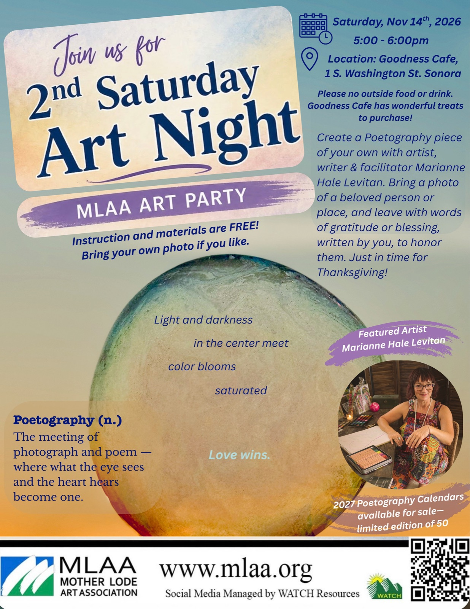

**Join us for 2nd Saturday Art Night — MLAA Art Party**

**Saturday, November 14, 2026, 5:00–6:00 p.m.**

Goodness Cafe, 1 S. Washington St., Sonora

Create a Poetography piece of your own with artist, writer & facilitator Marianne Hale Levitan. Bring a photo of a beloved person or place, and leave with words of gratitude or blessing, written by you, to honor them. Just in time for Thanksgiving!

- Instruction and materials are FREE! Bring your own photo if you like.
- Please no outside food or drink. Goodness Cafe has wonderful treats to purchase!
- 2027 Poetography Calendars available for sale — limited edition of 50

*Poetography (n.): The meeting of photograph and poem — where what the eye sees and the heart hears become one.*

Mother Lode Art Association: <https://www.mlaa.org>
